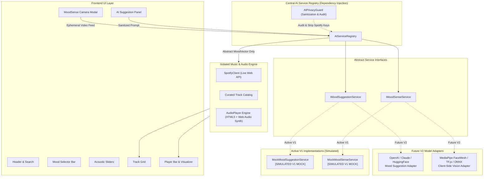

# MOODIFY — AI/ML Architecture & Future Model Integration Guide (V1 to V2)

> **Document Version:** 1.0.0  
> **Status:** Architecture Prepared & V1 Mock Services Active  
> **Target Release:** MOODIFY V1 (Core Production Player) & V2 (Real Model Integrations)

---

## 1. Executive Summary

Moodify was designed from the ground up with a **modular, air-gapped AI/ML architecture**. In V1, the application provides a fully functional, high-fidelity mood-based music experience utilizing simulated mock inference services.

This architecture ensures:
1. **Zero AI Blocking:** Core V1 application development, UI testing, audio synthesis, and Spotify music playback operate completely unimpeded without requiring model downloads or external API keys.
2. **Pluggable Model Architecture:** The frontend UI components and core playback engine communicate *strictly* through standardized service interfaces (`IMoodSuggestionService`, `IMoodSenseService`). Replacing simulated services with real AI/ML models requires modifying only the service registry adapter—**zero lines of frontend or music player code need to be rewritten**.
3. **Air-Gapped Data Isolation:** AI models operate on sanitized user prompts and abstract emotion vectors. **No Spotify metadata, album artwork, track names, lyrics, or listening history are ever sent to external AI providers.**
4. **Zero Biometric Retention:** Facial expression estimation runs strictly ephemerally in volatile client memory. **No camera images, video recordings, facial landmarks, or emotion logs are ever stored on disk, localStorage, cookies, or remote databases.**
5. **Camera AI Disabled in V1 & Scientific Honesty:** Live computer vision inference is deactivated during V1 until real models are integrated. Fabricated probabilities have been removed. Moodify provides an honest Camera-Free Mood Discovery workflow and notes that facial expressions are contextual cues, not definitive emotional states.

---

## 2. Architecture Diagram



---

## 3. Core Interface Contracts

All AI inference services are decoupled using clean interfaces defined in [`src/services/ai/interfaces/`](file:///d:/CLG/Hustle/Moodify/src/services/ai/interfaces/).

### 3.1. `IMoodSuggestionService`
Defined in [`IMoodSuggestionService.js`](file:///d:/CLG/Hustle/Moodify/src/services/ai/interfaces/IMoodSuggestionService.js). Handles freeform user vibes, temporal context, and activities.

```javascript
export class IMoodSuggestionService {
  /**
   * Evaluates user prompt and ephemeral context to suggest mood parameters.
   * @param {MoodSuggestionRequest} request - Sanitized prompt and context
   * @returns {Promise<MoodSuggestionResult>} Standardized mood recommendation
   */
  async suggestMood(request) { /* Subclass implements */ }

  /**
   * Health check for underlying provider / model endpoint.
   * @returns {Promise<boolean>}
   */
  async isAvailable() { /* Subclass implements */ }

  /**
   * Telemetry and model metadata.
   * @returns {{ provider: string, modelName: string, isSimulated: boolean, version: string }}
   */
  getModelInfo() { /* Subclass implements */ }
}
```

### 3.2. `IMoodSenseService`
Defined in [`IMoodSenseService.js`](file:///d:/CLG/Hustle/Moodify/src/services/ai/interfaces/IMoodSenseService.js). Handles real-time video stream facial expression estimation.

```javascript
export class IMoodSenseService {
  /**
   * Starts live expression estimation from an HTMLVideoElement.
   * @param {HTMLVideoElement} videoElement
   * @param {HTMLCanvasElement} [overlayCanvas] - Ephemeral canvas for reticle HUD
   * @param {(result: MoodSenseResult) => void} onUpdate
   * @param {Object} [options]
   */
  startAnalysis(videoElement, overlayCanvas, onUpdate, options = {}) { /* Subclass implements */ }

  /**
   * Halts active camera analysis and immediately purges canvas buffers.
   */
  stopAnalysis() { /* Subclass implements */ }

  /**
   * One-shot static estimation from a single video frame.
   * @param {HTMLCanvasElement | ImageData | HTMLVideoElement} frameSource
   * @returns {Promise<MoodSenseResult>}
   */
  async estimateMood(frameSource) { /* Subclass implements */ }

  /**
   * Checks if vision engine and camera access are available.
   * @returns {Promise<boolean>}
   */
  async isAvailable() { /* Subclass implements */ }

  /**
   * Model metadata.
   */
  getModelInfo() { /* Subclass implements */ }
}
```

---

## 4. Standard Data Transfer Objects (DTOs)

The AI layer outputs standardized data structures defined in [`types.js`](file:///d:/CLG/Hustle/Moodify/src/services/ai/types.js).

### `MoodVector`
The universal 3-axis acoustic coordinate bridge between AI inference and music matching:
```typescript
interface MoodVector {
  valence: number;       // 0.0 (Melancholic / Dark) to 1.0 (Euphoric / Bright)
  energy: number;        // 0.0 (Calm / Ambient) to 1.0 (Kinetic / Intense)
  danceability: number;  // 0.0 (Irregular / Subtle) to 1.0 (Groovy / Rhythmic)
  acousticness?: number; // 0.0 (Synthetic) to 1.0 (Organic Acoustic)
  tempo?: number;        // Target BPM (e.g. 120)
}
```

### `MoodSuggestionResult`
```typescript
interface MoodSuggestionResult {
  mood: string;                         // Standard category ('joyful', 'focused', 'chill', etc.)
  displayTitle: string;                 // Human-friendly title ('Deep Neural Focus')
  confidence: number;                   // 0.0 to 1.0
  rationale: string;                    // Model explanation text
  targetAudioFeatures: MoodVector;      // Target acoustic coordinates
  recommendedGenres: string[];          // Genre discovery tags
  isSimulated: boolean;                 // TRUE for V1 mock, FALSE for real model
  simulatedModelTag: string;            // e.g. "[SIMULATED V1 MOCK]"
  timestamp: number;
}
```

### `MoodSenseResult`
```typescript
interface MoodSenseResult {
  detectedMood: string;                 // e.g. 'joyful'
  confidence: number;                   // 0.0 to 1.0
  expressions: {                        // Normalized expression distribution
    happy: number;
    neutral: number;
    focused: number;
    chill: number;
    sad: number;
    surprised: number;
  };
  faceDetected: boolean;
  targetAudioFeatures: MoodVector;
  isSimulated: boolean;
  simulatedModelTag: string;
  privacyNotice: string;                // Guaranteed zero-storage affirmation
  timestamp: number;
}
```

---

## 5. Privacy & Air-Gap Compliance

Moodify implements automated privacy guards in [`privacyGuard.js`](file:///d:/CLG/Hustle/Moodify/src/services/ai/privacyGuard.js).

### Rule 8: Spotify Content Isolation
- External AI models MUST NEVER receive:
  - Spotify track titles, artist names, or album titles
  - Spotify URIs, IDs, or search queries
  - Album artwork images or binary buffers
  - Lyrics, audio previews, or streaming buffers
  - User Spotify tokens or credentials
- `AIPrivacyGuard.sanitizeSuggestionRequest()` inspects all outgoing payloads and strips any forbidden keys before forwarding to any AI provider.

### Rule 9: Zero Biometric Persistence
- Camera frames exist ONLY in volatile GPU/RAM buffers during active playback.
- When `stopAnalysis()` is called, `AIPrivacyGuard.purgeCanvasBuffer()` clears the canvas pixels to `(0, 0, 0, 0)`.
- `AIPrivacyGuard.auditBiometricStorageCompliance()` scans `localStorage` and `sessionStorage` on startup to assert that zero snapshots, facial landmarks, or expression logs exist in browser storage.

---

## 6. How to Integrate Real Models (Step-by-Step)

Thanks to `AIServiceRegistry`, swapping mock services for real models requires **no changes to UI components or player logic**.

### Step 6.1: Integrating a Real LLM Mood Suggestion Service

Create `src/services/ai/real/OpenAIMoodSuggestionService.js`:

```javascript
import { IMoodSuggestionService } from '../interfaces/IMoodSuggestionService.js';
import { AIPrivacyGuard } from '../privacyGuard.js';
import { MOOD_AUDIO_PROFILES, MoodCategories } from '../types.js';

export class OpenAIMoodSuggestionService extends IMoodSuggestionService {
  constructor({ apiKey, model = 'gpt-4o-mini' }) {
    super();
    this.apiKey = apiKey;
    this.model = model;
    this.providerName = 'OpenAI';
  }

  async suggestMood(rawRequest) {
    // 1. Strictly sanitize payload (enforces Rule 8)
    const request = AIPrivacyGuard.sanitizeSuggestionRequest(rawRequest);

    const systemPrompt = `
You are an expert musicologist and sonic emotional intelligence engine.
Analyze the user's prompt and context. Return a JSON object with:
- mood: one of ["joyful", "chill", "energetic", "focused", "cyberpunk", "melancholy", "euphoric", "romantic", "nature"]
- displayTitle: string
- confidence: number between 0.0 and 1.0
- rationale: brief explanation of musical choice
- valence: number (0.0 to 1.0)
- energy: number (0.0 to 1.0)
- danceability: number (0.0 to 1.0)
- recommendedGenres: array of strings
DO NOT reference Spotify, track names, or artist names. Output pure JSON only.`;

    const response = await fetch('https://api.openai.com/v1/chat/completions', {
      method: 'POST',
      headers: {
        'Content-Type': 'application/json',
        Authorization: `Bearer ${this.apiKey}`
      },
      body: JSON.stringify({
        model: this.model,
        messages: [
          { role: 'system', content: systemPrompt },
          { role: 'user', content: `Prompt: "${request.prompt}". Context: ${JSON.stringify(request.context || {})}` }
        ],
        response_format: { type: 'json_object' }
      })
    });

    if (!response.ok) {
      throw new Error(`OpenAI API error: ${response.statusText}`);
    }

    const data = await response.json();
    const parsed = JSON.parse(data.choices[0].message.content);

    return {
      mood: parsed.mood || MoodCategories.CHILL,
      displayTitle: parsed.displayTitle,
      confidence: parsed.confidence || 0.95,
      rationale: parsed.rationale,
      targetAudioFeatures: {
        valence: parsed.valence,
        energy: parsed.energy,
        danceability: parsed.danceability,
        tempo: parsed.tempo || 110
      },
      recommendedGenres: parsed.recommendedGenres || ['ambient'],
      isSimulated: false, // Flagged as real
      simulatedModelTag: `[OPENAI ${this.model.toUpperCase()}]`,
      timestamp: Date.now()
    };
  }

  async isAvailable() {
    return Boolean(this.apiKey);
  }

  getModelInfo() {
    return {
      provider: this.providerName,
      modelName: this.model,
      isSimulated: false,
      version: '2.0.0'
    };
  }
}
```

### Step 6.2: Integrating a Real Client-Side Vision Model (MediaPipe / FaceMesh)

Create `src/services/ai/real/MediaPipeMoodSenseService.js`:

```javascript
import { IMoodSenseService } from '../interfaces/IMoodSenseService.js';
import { AIPrivacyGuard } from '../privacyGuard.js';
import { MOOD_AUDIO_PROFILES, MoodCategories } from '../types.js';

export class MediaPipeMoodSenseService extends IMoodSenseService {
  constructor() {
    super();
    this.faceLandmarker = null;
    this.isRunning = false;
  }

  async initModel() {
    // Dynamically import @mediapipe/tasks-vision from CDN or npm
    const { FaceLandmarker, FilesetResolver } = await import('@mediapipe/tasks-vision');
    const filesetResolver = await FilesetResolver.forVisionTasks(
      'https://cdn.jsdelivr.net/npm/@mediapipe/tasks-vision@latest/wasm'
    );
    this.faceLandmarker = await FaceLandmarker.createFromOptions(filesetResolver, {
      baseOptions: {
        modelAssetPath: 'https://storage.googleapis.com/mediapipe-models/face_landmarker/face_landmarker/float16/1/face_landmarker.task',
        delegate: 'GPU'
      },
      outputFaceBlendshapes: true,
      runningMode: 'VIDEO',
      numFaces: 1
    });
  }

  startAnalysis(videoElement, overlayCanvas, onUpdate, options = {}) {
    this.isRunning = true;
    let lastVideoTime = -1;

    const loop = () => {
      if (!this.isRunning) return;

      if (videoElement.currentTime !== lastVideoTime && this.faceLandmarker) {
        lastVideoTime = videoElement.currentTime;
        const results = this.faceLandmarker.detectForVideo(videoElement, performance.now());

        if (results.faceBlendshapes && results.faceBlendshapes.length > 0) {
          const blendshapes = results.faceBlendshapes[0].categories;
          
          // Classify emotion from blendshapes (smile, brow down, eye wide)
          const smileLeft = blendshapes.find(b => b.categoryName === 'mouthSmileLeft')?.score || 0;
          const smileRight = blendshapes.find(b => b.categoryName === 'mouthSmileRight')?.score || 0;
          const smileScore = (smileLeft + smileRight) / 2;

          const browDownLeft = blendshapes.find(b => b.categoryName === 'browDownLeft')?.score || 0;
          const browDownRight = blendshapes.find(b => b.categoryName === 'browDownRight')?.score || 0;
          const focusScore = (browDownLeft + browDownRight) / 2;

          let detectedMood = MoodCategories.CHILL;
          if (smileScore > 0.5) detectedMood = MoodCategories.JOYFUL;
          else if (focusScore > 0.4) detectedMood = MoodCategories.FOCUSED;

          const profile = MOOD_AUDIO_PROFILES[detectedMood];

          onUpdate({
            detectedMood,
            confidence: Math.min(1.0, 0.75 + smileScore * 0.25),
            expressions: { happy: smileScore, focused: focusScore, chill: 0.5 },
            faceDetected: true,
            targetAudioFeatures: { ...profile },
            isSimulated: false,
            simulatedModelTag: '[MEDIAPIPE FACE LANDMARKER]',
            privacyNotice: 'Ephemeral client GPU processing. Zero images or landmarks stored.',
            timestamp: Date.now()
          });
        }
      }

      requestAnimationFrame(loop);
    };

    requestAnimationFrame(loop);
  }

  stopAnalysis() {
    this.isRunning = false;
    // Wipe canvas immediately (enforces Rule 9)
    if (this.canvas) {
      AIPrivacyGuard.purgeCanvasBuffer(this.canvas);
    }
  }

  async isAvailable() {
    return true;
  }

  getModelInfo() {
    return {
      provider: 'Google MediaPipe',
      modelName: 'FaceLandmarker V1',
      isSimulated: false,
      version: '2.0.0'
    };
  }
}
```

### Step 6.3: Activating Real Models via `AIServiceRegistry`

To activate real services in production, register them in your initialization routine:

```javascript
import { aiRegistry } from './services/ai/registry.js';
import { OpenAIMoodSuggestionService } from './services/ai/real/OpenAIMoodSuggestionService.js';
import { MediaPipeMoodSenseService } from './services/ai/real/MediaPipeMoodSenseService.js';

// Activate Real Services:
if (window.APP_CONFIG?.OPENAI_API_KEY) {
  aiRegistry.registerSuggestionService(
    new OpenAIMoodSuggestionService({ apiKey: window.APP_CONFIG.OPENAI_API_KEY })
  );
}

if (window.APP_CONFIG?.ENABLE_MEDIAPIPE) {
  const visionService = new MediaPipeMoodSenseService();
  await visionService.initModel();
  aiRegistry.registerSenseService(visionService);
}
```

**Notice:** The entire rest of Moodify (UI components, Spotify client, Audio synthesizer, sliders, and playback controls) continues running without a single modification!

---

## 7. Testing & Verification Checklist

Before deploying any new AI model adapter to production, verify compliance with this checklist:

| Verification Item | Requirement | Verification Method |
|---|---|---|
| **Interface Adherence** | Must extend `IMoodSuggestionService` or `IMoodSenseService` | `aiRegistry.register*` runtime type assertion |
| **Air-Gap Spotify Isolation** | Zero Spotify track metadata passed to external AI | Run `AIPrivacyGuard.sanitizeSuggestionRequest()` |
| **Zero Biometric Retention** | Zero camera images or face landmarks saved | Run `AIPrivacyGuard.auditBiometricStorageCompliance()` |
| **Simulation Transparency** | Real models flag `isSimulated: false`; mocks flag `isSimulated: true` | Visual badge validation on UI result cards |
| **Offline / Fallback Resilience** | If model inference fails, audio player continues playing seamlessly | Test playback with network disconnected |

---

## 8. Summary of Architectural Guarantees

1. **V1 is Fully Functional & Independent:** Moodify plays music, synthesizes audio chords, animates real-time spectrum visualizers, allows Spotify API pairing, and tests AI workflows without external dependencies.
2. **V2 is 100% Prepared:** Clear interface boundaries, strict privacy filters, and dependency injection make model integration straightforward and safe.
