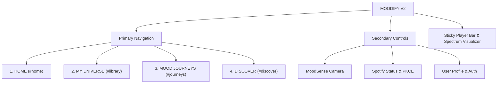

# MOODIFY V2 — Complete UX Audit & UI Redesign Report

**Date:** November 1, 2026  
**Version:** V2.0 (Visual & UX Polish)  
**Project:** MOODIFY — *"Your music. Your emotions. Your universe."*  
**Repository:** `https://github.com/Parth-why/moodify.git`

---

## 1. Executive Summary & UX Audit

### 1.1 The V1 UX Deficiencies
The V1 prototype was technically functional with Supabase PostgreSQL authentication, Spotify PKCE authorization, Web Audio synthesis, and multi-mood tagging. However, the user experience suffered from several critical structural flaws:

| Area | V1 Issue | V2 Solution |
| :--- | :--- | :--- |
| **Information Architecture** | All features were dumped onto a single, massive vertical scroll page. | Clean 4-destination top-level architecture: **HOME**, **MY UNIVERSE**, **MOOD JOURNEYS**, **DISCOVER**. |
| **Navigation** | Competing header tabs, modals, and scrolling buttons confused the user on where to go. | Segmented tab bar with glowing active state indicators and browser hash navigation (`#home`, `#library`, `#journeys`, `#discover`). |
| **Visual Clutter** | Over 12 competing cards, sliders, and buttons demanded attention simultaneously. | Disciplined visual hierarchy with dedicated hero cards, distinct content columns, and high-impact CTAs. |
| **Mood Journeys Experience** | Mood transition controls were buried beneath library lists and AI panels. | Re-imagined as a signature 5-step guided wizard with visual transition spectrums, waypoint nodes, and reordering. |
| **Personal Library Organization** | Library view had rudimentary list items without clear sorting, playlist source context, or search. | Full desktop-grade track table with album artwork, playlist badges, real-time multi-mood tags, search, and sorting. |
| **Color & Theme Inconsistency** | Mix of disparate neon cyans, purples, and high-contrast whites created visual fatigue. | Unified cinematic dark design system based strictly on `#09090F`, `#11111B`, `#181824`, `#222231`, with Soft Violet (`#A78BFA`), Electric Cyan (`#67D5F5`), and Warm Rose (`#F0A6CA`). |

---

## 2. New 4-Destination Information Architecture

MOODIFY's primary interface has been restructured into four purposeful destinations accessible via the top navigation bar:



### Secondary Controls in Header
Secondary actions are neatly tucked into the right section of the header:
- **MoodSense Camera Button:** Quick-trigger for simulated facial-expression emotion estimation.
- **Spotify Status Pill:** Live connection pill showing connection status with green accent glow and opening the Spotify management modal.
- **User Profile / Sign In:** User avatar thumb and display name opening profile management, or "Sign In" button when unauthenticated.

---

## 3. Cinematic Design System Tokens

The visual language follows a restrained, premium cinematic dark aesthetic:

| Token | Hex Value | Usage |
| :--- | :--- | :--- |
| `--bg-dark-0` | `#09090F` | Deep space canvas background |
| `--bg-dark-1` | `#11111B` | Secondary page containers and table headers |
| `--bg-card` | `#181824` | Primary glass cards and content panels |
| `--bg-surface-elevated` | `#222231` | Elevated hover states, active tabs, and secondary buttons |
| `--accent-primary` | `#A78BFA` | Primary soft violet accent (CTAs, active icons, indicators) |
| `--accent-secondary` | `#67D5F5` | Secondary electric cyan accent (spectrum nodes, tags) |
| `--accent-highlight` | `#F0A6CA` | Warm rose highlight (favorite hearts, special accents) |
| `--text-main` | `#F5F3FA` | Primary text and headings |
| `--text-secondary` | `#9995AA` | Secondary descriptions, subtexts, and metadata |
| `--text-muted` | `#6C687E` | Timestamps, durations, and inactive indicators |
| `--accent-spotify` | `#1ED760` | Official Spotify green (authentication pills, import CTAs) |

---

## 4. Screen-by-Screen Breakdown

### 4.1 Screen 1: HOME (`src/views/HomeView.js`)
- **Dynamic Time-of-Day Greeting:** Welcomes the user (*"Good evening, Parth"*) personalized with their Supabase profile.
- **Hero Card:** Cinematic hero card with soft violet ambient radial glow, emotional frequency tuner badge, clear primary CTA (*"Start a Mood Journey"*), and ambient tone synthesizer trigger.
- **Tune to a Mood Frequency:** Responsive 6-card grid allowing 1-click emotional tuning into top moods with emoji, color glow, and active playback indicator.
- **Curated Universe Highlights:** Left column displaying 4 recently added or curated tracks with album art, artist, and assigned mood tags.
- **Active Mood Journeys Card:** Right column displaying saved journey sessions or an inviting preview card encouraging the creation of the user's first journey.
- **Spotify Integration Card:** Dedicated status widget highlighting PKCE authorization state and direct playlist sync action.

### 4.2 Screen 2: MY UNIVERSE (`src/views/UniverseView.js`)
- **Library Constellation Header:** Summarizes cataloged tracks count and source playlist count with a prominent `+ Import Spotify Playlist` CTA.
- **Search & Filter Controls:**
  - Real-time search filtering by track title, artist, album, or mood tag.
  - Mood filter dropdown supporting all 12 default moods + custom user moods.
  - Sorting selector: *Date Added*, *Title*, *Artist*, *Duration*.
- **Desktop-Grade Track Table:**
  - Numerical index with play/pause button overlay on hover.
  - Album art thumbnail, bold track title, artist, and album name.
  - Source playlist badge (`✦ My Universe` or imported playlist name).
  - Multi-mood interactive pill cluster with inline `+` add tag trigger.
  - Formatted duration and cell actions (favorite heart toggle and delete).
- **Empty State:** Welcoming zero-state with glowing icon ring, guiding the user to import Spotify playlists or explore the Discover catalog.

### 4.3 Screen 3: MOOD JOURNEYS (`src/views/JourneysView.js`)
- **Signature Guided 5-Step Stepper Bar:**
  1. **Origin Mood:** Choose starting emotional state from the interactive mood grid.
  2. **Destination Mood:** Select target emotional state to transition towards.
  3. **Pacing & Duration:** Choose session length (15 min / 30 min / 60 min) and curve type (*Gentle Harmonic Arc* vs. *Dynamic Leap*).
  4. **Transition Preview:** Renders an animated gradient spectrum bar from Origin color to Destination color with waypoint track nodes and stage badges (*Stage 1*, *Stage 2*...).
  5. **Tune & Save:** Allows dragging/reordering tracks, playing the complete journey, and saving the journey into My Universe.
- **Saved Journeys Library:** Displays cards of saved journeys below the creator for instant 1-click replay.

### 4.4 Screen 4: DISCOVER (`src/views/DiscoverView.js`)
- **Editorial Spotlight Hero:** Magazine-style hero banner featuring *Midnight Neon Odyssey* with high-res artwork, evocative description, and *"Play Collection"* / *"+ Save to My Universe"* buttons.
- **Situational Moments:** Horizontal pill cards for everyday lifestyle contexts (*Late Night Coding*, *Morning Coffee Ritual*, *Peak Workout Cardio*, *Rainy Solitude*, *Sunset Highway Drive*, *Weekend Celebration*).
- **Curated Mood Collections:** 4 thematic editorial collections (*Midnight Neon Odyssey*, *Raindrops & Tape Cassettes*, *Golden Hour Sunbeams*, *Neural Architecture & Flow*) with rich album covers, ambient glow, and hover play buttons.
- **Independent Catalog Showcase:** 4-column card grid displaying MOODIFY's native tracks with album artwork, multi-mood tags, and `+ Add to Universe` buttons.

---

## 5. Persistent Player Bar & Visualizer

- **Sticky Bottom Placement:** Fixed bottom bar (`height: 84px`) with `glass-card-strong` background and subtle top border.
- **Now Playing Info:** Album thumbnail with `#mood` badge, track title, and artist.
- **Transport Controls:** Previous, Play/Pause with white circle button, Next, Shuffle, and Loop.
- **Real-Time Spectrum Visualizer:** 28-bar canvas visualizer updated to render smooth gradients between `#67D5F5` (Electric Cyan) and `#A78BFA` (Soft Violet).
- **Timeline Scrubbing:** Interactive progress track with time labels.
- **Volume & Engine Status:** Dedicated slider with mute toggle and `STEREO 48k` indicator badge.

---

## 6. Verification and Regression Testing

### 6.1 Automated Unit Tests
Executed `npm test` across all test suites:
- AI Privacy Guard (air-gap, forbidden metadata removal): **PASS**
- AI Service Registry (modular contracts, mock implementations): **PASS**
- Audio Playback & Node Isolation: **PASS**
- Supabase Authentication & Profile Management: **PASS**
- V1.5 Library Engine & Deduplication: **PASS**
- Local Data Migration: **PASS**
- Mood Management & Multi-Tagging Engine: **PASS**
- Spotify Policy Compliance (Euclidean distance removal): **PASS**
- Spotify PKCE OAuth Authorization: **PASS**

```
ℹ tests 40
ℹ suites 5
ℹ pass 40
ℹ fail 0
ℹ duration_ms 188.5ms
```

### 6.2 Production Build Verification
Executed `npm run build` with Vite:
- `dist/index.html`: 1.12 kB
- `dist/assets/index-BRID9P4o.css`: 68.43 kB (gzip: 12.10 kB)
- `dist/assets/index-BEWL8fPv.js`: 381.89 kB (gzip: 97.75 kB)
- Status: **SUCCESS** (0 errors, 0 warnings)

### 6.3 Responsive Verification
- **Desktop (> 1100px):** 6-column mood grid, 4-column discover grid, 2-column home layout, full 6-column universe table.
- **Tablet (860px - 1100px):** 3-column mood grid, 2-column discover grid, condensed universe table.
- **Mobile (< 580px):** Single-column stacked layouts, segmented mobile nav, full-width touch-friendly buttons, and compact sticky controls.
