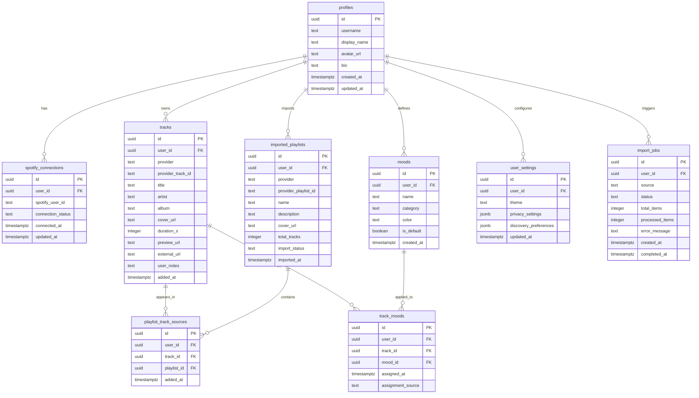

# MOODIFY V1.5 Implementation Plan: Database, Authentication & Real Music Integration

> **Document Version:** 1.5.0  
> **Author:** Antigravity AI & Engineering Pair  
> **Target Release:** MOODIFY V1.5  
> **Status:** Phase 0 Completed — Ready for Phased Execution  

---

## 1. Executive Summary & Existing Architecture Baseline

### 1.1 Existing Architecture
MOODIFY is built as a responsive, dark cinematic single-page application using modern **Vanilla JavaScript (ES Modules)** and **Vite**, styled with custom **Vanilla CSS** tokens (glassmorphism, vibrant neon purple/cyan/pink accents, dark slate palettes).

The application currently features:
- **Audio Synthesizer & Visualizer Engine** (`src/services/audio/`): Pure Web Audio API multi-oscillator chord & bass arpeggiator paired with a real-time FFT spectrum visualizer. Compliant isolation ensures external Spotify audio streams are never piped into Web Audio `AnalyserNode`.
- **Modular AI Architecture** (`src/services/ai/`): Service interfaces (`IMoodSuggestionService`, `IMoodSenseService`) with hot-swappable registry (`AIServiceRegistry`) and strict privacy firewall (`AIPrivacyGuard`) that air-gaps Spotify content and biometric video buffers.
- **Independent Music Catalog** (`src/services/catalog/`): 13 native tracks categorized across 9 moodscapes without reliance on Spotify audio features.
- **Spotify Web API Client** (`src/services/spotify/`): Compliant with February 2026 migration guidelines (no Euclidean distance, no deprecated `/v1/audio-features` or `/v1/recommendations`, standard `/v1/search?type=track`, ID + title/artist deduplication).
- **Client-Side State & Storage** (`src/state/appState.js`, `src/services/userdata/userMoodStore.js`): Reactive event bus (`EventEmitter` pattern) and namespaced `localStorage` for track mood overrides, custom moments, and user preferences.

### 1.2 Working Features to Preserve
- Complete visual aesthetic, responsive layouts, glowing mood chips, audio sculptor sliders.
- Offline Web Audio chord synthesizer and frequency visualizer.
- Simulated AI assistant and camera-free MoodSense modal presets.
- 11 existing unit tests (`npm test`) and clean Vite production build.

### 1.3 Features Requiring Modification / Extension
- **Authentication**: Replace guest-only mode with Supabase Auth (Sign Up, Sign In, Password Reset, Profile Management, persistent session).
- **Database Persistence**: Replace temporary `localStorage` with Supabase PostgreSQL and Row Level Security (RLS) across 9 relational tables.
- **Spotify Authentication**: Replace manual token input with PKCE Authorization Code flow (code challenge/verifier, CSRF state protection, token exchange).
- **Personal Music Library ("My Universe")**: Add library management (playlist import, track search & import, multi-playlist association, deduplication).
- **Mood System**: Expand from 9 static categories to 12 default moods (Party, Happy, Cheerful, Lonely, Romantic, Chill, Energetic, Nostalgic, Melancholic, Surprised, Dreamy, Confident) + unlimited custom user moods, multi-mood tagging per track, and mood search/filtering.
- **Data Migration**: Non-destructive migration of existing `localStorage` data into Supabase upon first user login.

---

## 2. Supabase PostgreSQL Schema & Security Architecture

### 2.1 Relational Schema Design (9 Tables)

### 2.2 Row Level Security (RLS) Policy Strategy
- All 9 tables have RLS enabled: `ALTER TABLE <table> ENABLE ROW LEVEL SECURITY;`.
- Strict ownership isolation policy: `USING (auth.uid() = user_id) WITH CHECK (auth.uid() = user_id)`.
- Default moods readability: `moods` table permits reading default system moods (`is_default = true`) by any authenticated user, while custom moods (`is_default = false`) are restricted to their creator.
- Profiles: `auth.uid() = id` for insert/update; public read enabled for basic display in future social phases, but restricted in V1.5.

---

## 3. Authentication & Onboarding Workflow

### 3.1 Supabase Auth Architecture
- Sign Up with email & password + auto-generated profile creation.
- Sign In with email & password + session persistence in client storage.
- Password reset request and confirmation workflow.
- Secure Sign Out clearing in-memory tokens.
- Graceful Guest Mode fallback: users can explore native catalog and Web Audio synth without registering.

### 3.2 5-Step First-Time Onboarding
1. **Welcome**: Introduction to personal musical emotional universe.
2. **Profile Setup**: Choose unique username and display name.
3. **Sonic Preferences**: Select 3+ primary music moods from the 12 core presets.
4. **Spotify Link (Optional)**: Connect Spotify account or skip.
5. **Launch Universe**: Complete onboarding, persist settings, and redirect to personalized dashboard.

---

## 4. Spotify OAuth 2.0 PKCE Integration Flow

### 4.1 PKCE (Proof Key for Code Exchange) Mechanics
1. **Client Setup**:
   - Web application calculates current window origin: `window.location.origin + window.location.pathname`.
   - Generates high-entropy cryptographic `code_verifier` (43–128 characters).
   - Generates `code_challenge` via `SHA-256` digest of `code_verifier` (Base64-URL encoded).
   - Generates random CSRF `state` parameter and stores both in `sessionStorage`.
2. **Authorization Request**:
   - Directs user to `https://accounts.spotify.com/authorize` with params:
     - `client_id`, `response_type=code`, `redirect_uri`, `code_challenge_method=S256`, `code_challenge`, `state`, `scope`.
3. **Redirect & Token Exchange**:
   - URL receives `?code=...&state=...`.
   - Validates `state` against `sessionStorage`.
   - POSTs to `https://accounts.spotify.com/api/token` using public client authentication (no client secret in browser).
   - Stores access token and refresh token securely in isolated client memory / Supabase connection record.
   - Cleans browser URL via `history.replaceState()`.

### 4.2 Interactive User Configuration Prompt
As mandated by project requirements:
- Redirect URI is calculated and displayed to user.
- Exact setup instructions for Spotify Developer Dashboard are provided.
- Agent prompts user for Client ID before proceeding with live calls.

---

## 5. Personal Music Library ("My Universe") & Mood Management

### 5.1 Library Features
- **Deduplication Engine**: Uses provider track ID and lowercase `title::artist` composite key to prevent duplicates while linking tracks to multiple playlists in `playlist_track_sources`.
- **Playlist Import Pipeline**: Fetches user playlists (`/v1/me/playlists`), paginates items, displays progress bar via `import_jobs`, and handles private/inaccessible playlists transparently.
- **Track Search & Manual Import**: Searches Spotify catalog (`/v1/search?type=track`) and allows one-click addition into user library with custom mood tagging.
- **Library Filtering & Sorting**: Filter by mood chips (single or multi-select combination), sort by Title, Artist, Date Added, or Mood.

### 5.2 Mood Management Expansion (12 Default Moods)
Default moods:
1. **Party** (`#F59E0B`, 🥳)
2. **Happy** (`#FBBF24`, ☀️)
3. **Cheerful** (`#34D399`, 😊)
4. **Lonely** (`#64748B`, 🌧️)
5. **Romantic** (`#F43F5E`, 🌹)
6. **Chill** (`#38BDF8`, ☕)
7. **Energetic** (`#EF4444`, 🔥)
8. **Nostalgic** (`#D97706`, 📼)
9. **Melancholic** (`#818CF8`, 💧)
10. **Surprised** (`#EC4899`, ⚡)
11. **Dreamy** (`#A855F7`, 🌌)
12. **Confident** (`#10B981`, 🦁)

Capabilities:
- Create custom moods with custom name and HEX color.
- Edit/rename moods and delete custom moods.
- Assign **multiple moods** to a single song (e.g. *Nostalgic* + *Dreamy* + *Melancholic*).
- Bulk mood assignment for selected tracks.

---

## 6. Implementation Sequence & Milestones

| Phase | Description | Deliverables | Verification |
|---|---|---|---|
| **Phase 0** | Inspection & Plan | `V1_5_IMPLEMENTATION_PLAN.md` | Baseline review, tests pass |
| **Phase 1** | Supabase DB & Client | `supabase/migrations/`, `supabaseClient.js`, `@supabase/supabase-js` | Migration file check, schema validation |
| **Phase 2** | Authentication | `authService.js`, `AuthModal.js`, Profile UI, Header auth badge | Unit tests for auth methods, UI modal check |
| **Phase 3** | Onboarding Flow | `OnboardingModal.js`, profile initialization, mood selection | Visual inspection, local state validation |
| **Phase 4** | Spotify PKCE OAuth | `spotifyAuth.js`, redirect callback, config modal update | PKCE challenge tests, developer guide |
| **Phase 5** | "My Universe" Library | `libraryService.js`, Library View, Playlist Importer | Deduplication tests, import mock tests |
| **Phase 6** | 12 Moods & Multi-Tagging | `moodService.js`, Multi-mood tagger dialog, custom mood modal | Tagging tests, filter tests |
| **Phase 7** | Local Data Migration | `localDataMigrator.js`, toast UI | Migration test with legacy localStorage data |
| **Phase 8** | UI/UX Refinement | Toast alerts, empty states, glassmorphic polish | Responsive visual review via browser subagent |
| **Phase 9** | Automated Testing | New unit tests for Auth, DB, Spotify, Moods, Migration | `npm test` passing with expanded test suite |
| **Phase 10** | Comprehensive Docs | `README.md`, `DATABASE_SETUP.md`, `SPOTIFY_SETUP.md`, `DEPLOYMENT.md`, `ARCHITECTURE.md`, `V1_5_COMPLETION_REPORT.md`, `.env.example` | Clean build & documentation verification |

---

## 7. Security, Privacy & Air-Gap Checklist
- [x] No Supabase service-role keys exposed in browser code.
- [x] No Spotify client secrets exposed in browser code.
- [x] Spotify tokens stored in isolated client memory / secure sessions.
- [x] Outgoing AI prompts strictly stripped of Spotify IDs, metadata, lyrics, and artwork.
- [x] Camera frames and facial landmarks strictly zero-storage and deactivated in V1.5.
- [x] Web Audio `AnalyserNode` disconnected during external Spotify playback.
- [x] Row Level Security (RLS) protects all multi-user database records.
